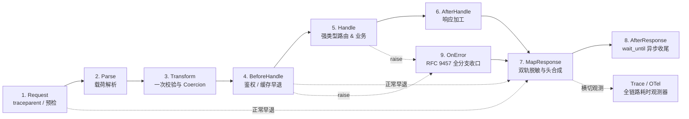

<a id="top"></a>

<div align="center">

# ✨ ciallo

**「Ciallo～(∠・ω< )⌒★ —— 给全宇宙的 HTTP 请求和运行时，打一声最元气的招呼！」**
*"Ciallo～(∠・ω< )⌒★ — Say hi to every HTTP request and runtime across the MoonBit multiverse!"*

面向 [MoonBit](https://www.moonbitlang.com) 多后端的现代全栈 Web 标准框架（Native · JS / Edge · WASI）
A WinterTC-inspired, cross-runtime, full-stack Web framework for MoonBit — playful on the outside, relentlessly strict under the hood

<br/>


[中文](#-中文) · [English](#-english) · [文档大本营 Docs](docs/README.md) · [硬核调研 References](docs/references.md) · [攻略路线 Roadmap](docs/spec/roadmap-and-acceptance.md)

</div>

---

<a id="-中文"></a>

## 🇨🇳 中文

### 登场！为什么又要造一个 Web 框架？

> *「Ciallo～(∠・ω< )⌒★！别问为什么叫这个名字——问就是 HTTP 服务器每天都在跟成千上万个 Request 打招呼，顺便一脚把祖传洋葱中间件、运行时反射 IoC 和 TS 类型体操踹出大气层！」*

Yo，欢迎误入（或者慕名点进）**ciallo** 的地盘！(ﾉ>ω<)ﾉ
如果你馋过 Hono 的边缘极速、眼热过 h3 / `srvx` 的跨运行时优雅，对 ElysiaJS + Eden Treaty「一个路由即全套契约与双端 RPC」的爽感念念不忘，又希望拿到 Spring Boot Starter 的零决策装配、Rust Tower 的韧性取消传播与 GoFrame 的开箱即用标准件（且**绝不背运行时反射和大单体包袱**）——恭喜你，现在终于不用在 MoonBit 里干瞪眼了！

**「小孩子才做选择，跨端 Web 标准、零反射全栈契约和生产级运维完备度我全都要！(๑•̀ㅂ•́)و✧」**

于是 **ciallo** 就这么蹦出来了——表面上颜文字乱飞、嘴上爱吐槽，骨子里却奉行 **「核心保持极简、外围按需生长、发版严格按步来」** 的硬核路线：

- **底座独立出圈（`unmbt/webstd`）**：用 `moon.work` 多模块 Workspace 把 `url` 和 `http`（含一等公民 **SSE / NDJSON Streaming**）单独拆成零 I/O、零异步、全四目标兼容的 Web 标准纯核（MoonBit 生态自己的 WinterTC / `srvx` 基石）。整个社区都能零包袱直接 `import`；千奇百怪的请求统统收敛成一句干脆利落的 `App::fetch(Request) -> Response`；
- **上层数值拉满（`unmbt/ciallo` + `unmbt/ciallo-gen`）**：吃满 MoonBit 原生的 `enum`、`pub(all) suberror` / `raise`、`trait`、`#derive(ToJson, FromJson)` 与 `pre-build` 代码生成——把 **显式 9 阶段生命周期**、**默认局部作用域隔离**、**原生 `raise` 强类型 Extractor**、**RFC 9457 全分支错误契约**、**`#ciallo.schema` 单一数据源 + 双轨零开销出参脱敏**、**OpenAPI 3.1 + Scalar 交互式文档**、**编译期 DI + 拓扑 `Lifecycle` + `CapabilityBundle`** 以及 **`ciallo-eden` MoonBit & 零依赖 TypeScript 双端 RPC SDK** 焊成一套丝滑连招；
- **全平台随时空降 & 生态按需生长**：业务代码只写这一份！裸机挂 **`unmbt/ciallo-native`**（含 `SIGTERM` 拓扑逆序优雅停机 + 请求级 `TaskGroup` 取消传播）；边缘云挂 **`unmbt/ciallo-js`** 用 `--target js` 零依赖空降 Cloudflare Workers / Vercel Edge / Deno / Bun / Node.js；全部公开包自带面向 `mooncakes.io` AI Agent 的 **`SKILL.md`**，版本联动与拓扑发版全权交给同家族的 [`unmbt/moonset`](https://github.com/unmbt/moonset)！

> [!NOTE]
> **当前进度：`v0.1`（Phase 0 → Phase 6）已全面实施并通过全目标 `--deny-warn`、`moon fmt --check`、`tsc --noEmit --strict` 与 `moonset` 发版门禁**
> 工程总纲 [AGENTS.md](AGENTS.md)、十三篇架构决策 [ADR-001 ~ ADR-013](docs/decisions/README.md) 以及 Web / 代码生成 / 测试 / 数据套件全量 `declare` 强类型接口契约已全部定稿。按三代清晰闭环推进：
> - **`v0.1`（Web 立威 · Phase 0–6）**：`webstd`（一等公民结构化 `Cookie` + `status_reason` + `StreamError` + 四目标纯同步 `SseDecoder`/`NdjsonDecoder`）+ `ciallo`（统一 `Int32`/`UInt32` 规范名、强类型 `ContextKey[T]`、`EnvBuilder`/只读 `Env`、`AppBuildError`、`*_typed` & `*_sse_typed` 路由 + `with_query`、`NoContent` `204` 哨兵、`Nullable[T]` 三态与 `Base64Bytes`、防爆栈 `SchemaRef`、`Int64String` 字符串契约、双轨脱敏、手写 RFC 9457 `ProblemDetails`、有界队列取消安全 SSE 心跳、统一 `Page[T]`/`CursorPage[T]`）+ `ciallo-native`（纯 `native`：`idle_conns` 秒醒 + 子协程有界排空 + 早退未读 Body 断连 + UTF-8 `Content-Length` + 1:1 `Cookie` 桥接）+ `ciallo-js`（`FixedArray` FFI + `#export_name("fetch")` + `worker.mjs` 薄胶水）+ `ciallo-gen`（双模 `rule`/`dev_build` + `moonx`：`#ciallo.schema` 严格规范拼写编译器委托 + 消费 `openapi.json` 的 `ciallo-eden` MoonBit/TS RPC SDK）+ `ciallo-testing`（含 `sync_openapi`）+ 可离线转义 Scalar UI + 包级 `SKILL.md`；
> - **`v0.2`（全栈数据闭环 · Phase 7–9）**：`ciallo-data`（含 `Lease::mark_tainted` 脏连接驱逐）+ `ciallo-orm`（纯核 + 独立 PG/SQLite/D1 驱动桥接包 + `UserQueries[E]`）+ **`ciallo-migrate`** + 纯独立 `ciallo-redis`（纯值 `RedisKey` + `SingleFlight` 内置 `RedisClient`，配 `ciallo-redis-plugin`）+ ORM 事务回滚测试 + `ciallo-gen wire` 编译期 DI & `FieldMask`；
> - **`v0.3`（企业级与 AI 生态 · Phase 10）**：按需 Tree-shake 的 **`ciallo-kit` 微包集群**（`config`/`Secret[T]`、`problem`、`log`、`id` UUIDv7、`security`、`resilience`、`actuator`、`otel`、`queue`）、**`ciallo-mcp`（路由即 MCP Server）** 与 WASI / WebSocket；`ciallo-mongo` 与 MySQL 方言归入独立孵化轨道。
> 详见 [需求规格矩阵](docs/spec/requirements.md) 与 [执行路线图](docs/spec/roadmap-and-acceptance.md)。

### ciallo 的八大核心被动（绝不画饼版）

看着跳脱，工程底线却比钛合金还硬——以下八条不变量全部写进规格书，绝不打折 ( `д´)

| | 核心被动 | 人话翻译 |
|:-:|---|---|
| 🧊 | **标准纯核独立** | Web 标准核独立发布为 **`unmbt/webstd`**（`url` + `http` + 一等公民 **SSE / NDJSON**），绝不沾染 Socket、异步运行时或宿主 FFI，在 `native` / `js` / `wasm` / `wasm-gc` 四端原汁原味通过测试。 |
| ⚡ | **9 阶段直通管线 + 取消传播** | 跟顺序靠猜的洋葱中间件说再见！每次请求按 9 个显式阶段推进，空阶段零分配跳过、参数懒加载；客户端断连或超时自动取消请求 `TaskGroup`，取消信号一路透传给 SQL / Redis / 出站 HTTP，零僵尸协程！ |
| 🚧 | **局部隔离 + `CapabilityBundle`** | 子应用和插件默认 `Scope::Local` 防串台 + `(name, seed)` 自动去重；`app.use_bundle(...)` 吸收 Spring Boot Starter 体验，一行挂载能力容器 + `/readyz` 探针 + `Trace` + `SIGTERM` 拓扑逆序优雅关闭（零运行时反射！）。 |
| 🎯 | **原生 Extractor + RFC 9457** | 吃满 MoonBit `raise` 异常自动传播：`ctx.param_as` / `query_as` / `json_as` / `require` 零嵌套 `match`，失败自动落入 `OnError` 转成 **RFC 9457 `application/problem+json`** 并写入 OpenAPI 3.1。 |
| 🕶️ | **SSOT 代码生成 + 双轨零开销脱敏** | `#ciallo.schema` 构建期生成 `SchemaNode`，彻底消灭 Struct/Schema 双份维护！强类型 DTO（`ctx.ok(dto)`）走编译期脱敏**零额外遍历**；动态 JSON / 稀疏投影走 `MapResponse` 白名单裁剪，`passwordHash` 绝不外泄！(σﾟ∀ﾟ)σ |
| 🔌 | **双端 RPC + 路由即 MCP** | **`ciallo-eden`** 从路由契约一键生成 **强类型 MoonBit SDK** + **零依赖 TypeScript SDK（`.ts`/`.d.ts`）**，后端改字段前端 `tsc` 当场红线；`v0.3` 的 **`ciallo-mcp`** 零额外代码把路由暴露成 MCP Server！ |
| 🧰 | **按需 Tree-shake 工具箱** | 吸收 GoFrame / Tower / Spring Actuator 精华却绝不做臃肿大单体：`ciallo-config`（`Secret[T]` 永输出 `"[REDACTED]"`）、`ciallo-id`（UUIDv7）、`ciallo-resilience`（`Idempotency-Key`/限流/熔断）、`ciallo-actuator`（`/healthz` `/readyz` `/metrics`）全部按需引入。 |
| 🚀 | **云边无缝切线 + 全包 `SKILL.md`** | `Env`、`ExecutionContext::wait_until`、`KvStore`/`HttpClient`/`Clock` 与 W3C `traceparent` 天生一等公民；Native 优雅停机代码在 Workers `--target js` 自动 Tree-shake；每个公开包附带 `SKILL.md` 原生对接 AI Agent！ |

### 9 阶段请求连招（8 主干 + 第 9 阶段 `OnError`，外加横切 `Trace` 观测器）

再也不用在一堆 `await next()` 里玩迷宫逃生了——每个请求沿着 8 个清晰明确的主干节拍推进，正常早退直达 `MapResponse`、异常统一由第 9 阶段 `OnError` 收口，全程耗时由横切 `Trace` + W3C `traceparent` 观测器自动录屏：



### 抢先试吃（设计预览）

看一眼现代 MoonBit 写服务端有多丝滑——`#ciallo.schema` 单一数据源、强类型 `ContextKey[T]`（零反射零字符串查找）、主力强类型路由 `post_typed`（一次校验 + 自动写入 OpenAPI + 编译期锁死轨道 1 脱敏）、一等公民 SSE 与 `CapabilityBundle` 一气呵成：

```moonbit
// 1. 单一数据源：#ciallo.schema 经 moonx + dev_build 生成 impl @ciallo.Schema（含唯一 schema_id）
#ciallo.schema
#derive(ToJson, FromJson)
pub struct CreatePostReq {
  #ciallo.string(min_len=1, max_len=120)
  title : String
  content : String
}

#ciallo.schema
#derive(ToJson, FromJson)
pub struct PostOut {
  id : Int64
  title : String
  author : String
}

// 零反射强类型上下文键（彻底替代字符串 Key 查找）
pub let auth_user_key : @ciallo.ContextKey[AuthUser] = @ciallo.ContextKey::ContextKey("auth_user")

// 2. 组装应用：CapabilityBundle + 主力强类型路由 post_typed + 原生 raise Extractor + SSE
pub fn build_app(redis_cfg : @ciallo_redis.RedisConfig) -> @ciallo.App raise @ciallo.AppBuildError {
  @ciallo.App::App()
  .use_bundle(@ciallo_redis_plugin.bundle(redis_cfg)) // 一键挂载客户端 + /readyz + Trace + SIGTERM 优雅排空
  .post_typed(
    "/users/:id/posts",
    status=201,
    options=@ciallo.RouteOptions::RouteOptions(
      summary="发布文章",
      bearer_auth=true,
    ),
    async fn(ctx, body : CreatePostReq) -> PostOut raise {
      // 自动一次校验 CreatePostReq 并写入 OpenAPI 3.1；失败直接 raise 转 RFC 9457 422！
      let user_id : Int64 = ctx.param_as("id")
      let current_user = ctx.require(auth_user_key) // 自动推导为 AuthUser，零字符串查找
      let post = create_post(user_id, current_user, body)
      // 编译器静态锁死返回类型 == PostOut，轨道 1 脱敏 0 遍历且绝不可绕过！
      PostOut::from(post)
    },
  )
  .get("/ai/chat/stream", async fn(ctx) {
    // 逃生舱动态路由 + 一等公民 SSE 流式响应：Native 逐块 flush，CF Workers 原生背压 ReadableStream！
    ctx.sse_events(next_llm_token_event)
  })
}

// 3. 同一份 app，想空降哪片战场随便挑：
// - 内存单测：let client = @ciallo_testing.TestClient::TestClient(app); let resp = client.get("/docs")
// - Native ：@ciallo_native.serve(app, options=@ciallo_native.NativeServerOptions::NativeServerOptions(port=8080))
// - Workers：export default { fetch: @ciallo_js.to_fetch_handler(app) }
// - 前端 SDK：`moonx unmbt/ciallo-gen/cmd/ciallo-gen@0.1.0 eden --from openapi.json --out ./web/src/api.ts`
```

> **等一下！(・_・;) 为什么 Cloudflare Workers 反而选 `--target js` 而不是 Wasm？**
> 因为 Workers 本身就跑在 V8 Isolate 里呀！用 MoonBit 直接编译出极致 Tree-shaken 的纯净 ES Module，既不会撞上动态 Wasm 实例化的限制，又能省掉跨 JS/Wasm 线性内存来回搬运 Headers 和 JSON 的冤枉开销，还能把 `env.KV`、`env.D1`、`ctx.waitUntil` 原封不动直接拿来用，且 Native 优雅停机代码自动 Tree-shake 归零（详见 [ADR-001](docs/decisions/001-neutral-http-core-and-runtime-adapters.md)）。

### 官方数据套件：底座共享，范式原生（`v0.2` 全栈数据闭环）

写完路由没有顺手的数据库、迁移和缓存怎么行？咱们立下铁律：**绝不做硬塞 SQL + NoSQL 的缝合怪「万能 ORM」，也绝不污染 `unmbt/webstd` 与 `unmbt/ciallo` 核心！**
在 `v0.2`（Phase 7–9，详见 [ADR-006](docs/decisions/006-data-suite-orm-redis-mongodb.md)、[ADR-009](docs/decisions/009-phased-release-cadence-v01-v03-and-incubation.md) 与 [数据套件契约](docs/spec/data-suite-contracts.md)）聚焦打穿最核心的生产闭环：

- **SQL ORM（`unmbt/ciallo-orm` + `unmbt/ciallo-gen`）**：**先死磕 PostgreSQL + SQLite / Cloudflare D1**！Drizzle 组合美学 + `pre-build` 零反射代码生成 + MoonBit 命名可选参数 & 三态 `Patch` 干掉 `ActiveModel` + `#orm.sql` sqlc 逃生舱 + `Page[T]`/`CursorPage[T]` + 闭包 `SAVEPOINT` 事务 + `#callsite(autofill(loc))` & **SQLCommenter**（`/* traceparent='...', loc='users.mbt:42' */`）+ 防 N+1 预加载 + Virtual Package 多端驱动切换。
- **数据库迁移与防漂移（`unmbt/ciallo-migrate`）**：集成进 `ciallo-gen migrate`，支持 `diff`（自动生成 `up.sql`/`down.sql`）、`status`/`apply`/`verify`（`_ciallo_migrations` 校验和漂移检测）与幂等 `seed`。
- **Redis（`unmbt/ciallo-redis` + `unmbt/ciallo-redis-plugin`）**：RESP2/3 + `core/async` 单线程协程**零锁多路复用 Auto-Pipelining** + 命名可选参数命令 + 强类型元组 `pipe2`/`pipe3` + Typed Lua + **无状态纯值 `RedisKey[K, V]`（`SingleFlight` 下沉 `RedisClient` 防缓存击穿）** + `RedisKvStore` + `@ciallo_redis_plugin.bundle`。
- **测试体验（`unmbt/ciallo-testing`）**：流式 `TestClient`（Cookie Jar + Bearer）+ `debug_inspect` HTTP/SQL 快照 + 借鉴 `sqlx::test` 的 **ORM 用例级自动事务回滚测试器（`with_rollback_tx`）**！
- **独立孵化轨道**：`unmbt/ciallo-mongo`（纯 MoonBit BSON 1.1 + `OP_MSG` + `SCRAM-SHA-256` + SDAM 副本集拓扑发现）与 MySQL 方言独立孵化，不拖慢主线发布节奏。

```moonbit
// ORM 轨道 A（包内 UserQueries[E] + 命名可选参数 + Patch 三态，Db 与 DbTx 无缝切换！）
let users = UserQueries::of(db)
let alice = users.insert_user(email="alice@moon.dev", name="Alice", age=24)
users.update_user_by_id(alice.id, name="Alice Wang", bio=Clear)

// Redis Schema-Safe Key + SingleFlight 防缓存击穿（100 并发只回源 1 次！）
let user_cache : @ciallo_redis.RedisKey[Int64, User] =
  @ciallo_redis.RedisKey::json(prefix="v1:user:", ttl_secs=300)
let user = user_cache.get_or_load(redis, 42L, async fn() { users.find_user_by_id(42L) })
```

### 生态版图 & 三级依赖治理矩阵

保持 **核心极简、外围按需 Tree-shake** 原则：Tier 0（`webstd`）与 Tier 1（`ciallo` / 适配器 / `testing`）全面基于标准库 `moonbitlang/core/async*`（**零第三方运行时依赖**），由根 `moon.work` + [`unmbt/moonset`](https://github.com/unmbt/moonset) 统一治理：

| 生态分层 | 模块成员 | 目标阶段与策略 |
| :--- | :--- | :--- |
| **核心层（Tier 0/1 极简纯核）** | **`unmbt/webstd`**（独立四目标 + 同步 `SseDecoder`）、**`unmbt/ciallo`**（含 `ContextKey[T]` / `Page[T]`）、**`unmbt/ciallo-native`**（纯 `native`）、**`unmbt/ciallo-js`** | `v0.1` 主线（`webstd` 独立版本线；`ciallo-wasi` 排入 `v0.3`） |
| **契约与全栈提效层** | **`unmbt/ciallo-gen`**（Tier 2，`moonx` + `rule`/`dev_build`：`#ciallo.schema` + DI + 消费 `openapi.json` 的 **`ciallo-eden`** + `#orm.*`）、**`unmbt/ciallo-mcp`** | `ciallo-gen` & `eden` 随 `v0.1` 交付；`ciallo-mcp` 随 `v0.3` 交付 |
| **数据闭环层** | **`unmbt/ciallo-data`**、**`unmbt/ciallo-orm`**（纯核 + 独立 PG/SQLite/D1 驱动桥接包）、**`unmbt/ciallo-migrate`**、纯独立 **`unmbt/ciallo-redis`** + **`ciallo-redis-plugin`** | `v0.2` 全栈数据闭环（`ciallo-mongo` 与 MySQL 方言归入独立孵化） |
| **企业级工具箱（按需 Tree-shake）** | `ciallo-config`（含 `Secret[T]`）、`ciallo-problem`、`ciallo-log`、`ciallo-id`（UUIDv7）、`ciallo-security`、`ciallo-resilience`（限流/`Idempotency-Key`/熔断）、`ciallo-actuator`（`/healthz` `/readyz` `/metrics`）、`ciallo-otel`、`ciallo-queue`（含 Transactional Outbox / CF Queues） | `v0.3` 按需微包集群，绝不反向污染 `webstd` 与 `ciallo` 纯核 |
| **研发与测试工具** | **`unmbt/ciallo-testing`**（流式 `TestClient` + Mock 套件 + ORM 自动事务回滚）+ 全公开包 **`SKILL.md`** | `v0.1` Web 版 + `SKILL.md`；`v0.2` 增 DB 事务回滚辅助器 |

### 攻略路线图（Roadmap）

| 里程碑 | 阶段 | 攻略主题 | 当前状态 |
|:-:|:-:|---|:-:|
| **`v0.1`<br/>Web 立威** | 0 | Workspace SDD 规格、ADR 001～013 与全量 `declare` 契约 | 已完成 |
| | 1 | 独立 Web 标准包 `unmbt/webstd`（含 SSE/NDJSON）与 `router`（四目标） | 已完成 |
| | 2 | `schema` 校验 / Coercion / 双轨脱敏与 `openapi` 3.1 + Scalar UI（四目标） | 已完成 |
| | 3 | `runtime`（`Lifecycle`/`HealthCheck`/`TraceContext`）与 `core`（9 阶段 / Extractor / RFC 9457 / `CapabilityBundle`） | 已完成 |
| | 4 | `unmbt/ciallo-native`（优雅停机 + 取消传播）与 `unmbt/ciallo-js` | 已完成 |
| | 5 | `unmbt/ciallo-gen`（`#ciallo.schema` / `ciallo-eden` MoonBit+TS SDK）、`ciallo-testing`、`examples/` 与包级 `SKILL.md` | 已完成 |
| | 6 | 全目标 `--deny-warn`、`moonset` 拓扑发版演练与 `v0.1.0` 正式收口 | 已完成 |
| **`v0.2`<br/>数据闭环** | 7 | `unmbt/ciallo-data`（SQLCommenter / 取消传播）+ `unmbt/ciallo-orm` MVP（PG + SQLite/D1） | 数据闭环 |
| | 8 | `unmbt/ciallo-gen` ORM 扩展（`#orm.*`/`#orm.sql`）+ **`unmbt/ciallo-migrate`**（Schema Diff / 防漂移 / Seed） | 数据闭环 |
| | 9 | ORM 生产 Hook / Virtual Package 驱动 + **`unmbt/ciallo-redis`** + `ciallo-testing` 事务回滚测试 | 数据闭环 |
| **`v0.3`<br/>企业 & AI** | 10 | **`ciallo-kit` 微包集群** + **`unmbt/ciallo-mcp`**（路由即 MCP Server）+ `ciallo-wasi` & WebSocket | 生态扩展 |
| **独立孵化** | — | `unmbt/ciallo-mongo`（BSON 1.1 + `OP_MSG` + SDAM）与 MySQL 方言插件 | 独立孵化轨道 |

每个阶段都写死了必测 TDD 用例和门禁退出条件，详见 [分阶段执行路线](docs/spec/roadmap-and-acceptance.md)。

### 文档传送门

[工程总纲 AGENTS](AGENTS.md) · [文档总览](docs/README.md) · [SDD 规约](docs/sdd.md) · [需求规格矩阵](docs/spec/requirements.md) · [Web 架构与契约](docs/spec/architecture-and-contracts.md) · [数据套件契约](docs/spec/data-suite-contracts.md) · [核心算法与机制](docs/spec/algorithms-and-mechanisms.md) · [执行路线与门禁](docs/spec/roadmap-and-acceptance.md) · [调研剖析 References](docs/references.md) · [架构决策 ADR 001~011](docs/decisions/README.md)

### 一起来玩（开发与发版指令）

```bash
moon check --deny-warn     # 严格类型检查 + 零警告门禁
moon test                  # 跑遍多目标单元测试
moon info && moon fmt      # 刷新 .mbti 接口快照并格式化

# 使用 unmbt/moonset 管理 Workspace 变更与发版
moonset add                # 记一笔 changeset 变更说明
moonset status --verbose   # 预览受影响模块与拓扑发布计划
moonset version            # 同步多模块版本、内部依赖与 CHANGELOG.md
moonset publish --dry-run  # 演练按拓扑序发布到 mooncakes.io
```

欢迎随时来拍 Issue、丢 PR 或者来聊聊离谱的新点子！(ﾉ´ヮ`)ﾉ*:･ﾟ✧
动键盘前请先速览 [AGENTS.md](AGENTS.md) 和 [docs/sdd.md](docs/sdd.md)——咱们这儿规矩很简单：**先立契约，再写代码，绝不裸奔！**

### 许可

以 MIT 协议开源授权。

<div align="right"><a href="#top">↑ 弹射回顶部</a></div>

---

<a id="-english"></a>

## 🇬🇧 English

### Enter ciallo — Wait, Another Web Framework?

> *"Ciallo～(∠・ω< )⌒★! Why the name? Because an HTTP framework spends its whole life saying hi to incoming requests — while politely kicking tangled onion middleware, runtime-reflection IoC, and TS type gymnastics out the airlock!"*

Hey there, welcome to **ciallo**! (ﾉ>ω<)ﾉ
If you've loved Hono's edge-first speed, admired h3 / `srvx` for keeping HTTP runtime-agnostic, grinned at ElysiaJS + Eden Treaty's "one route = the entire contract & RPC SDK" magic, and wished for Spring Boot Starter's zero-fatigue wiring, Rust Tower's resilience, and GoFrame's cohesive standard kit — **without runtime reflection or monolithic bloat** — you're right at home.

**"Why pick one when we can have Web Standards, zero-reflection full-stack contracts, and production ops out of the box? (๑•̀ㅂ•́)و✧"**

That's **ciallo** in a nutshell — cheerful and cheeky on the outside, obsessively disciplined on the inside (**keep the core razor-thin, grow the ecosystem modularly, ship in tight loops**):

- **Standalone Web Standards core (`unmbt/webstd`)**: `url` and `http` (including first-class **SSE & NDJSON Streaming**) ship as a zero-I/O, zero-async, 4-target pure package (`native`, `js`, `wasm`, `wasm-gc`) — MoonBit's own WinterTC / `srvx` foundation that any library can `import` without dragging in a framework.
- **Overpowered ergonomics, zero reflection (`unmbt/ciallo` + `unmbt/ciallo-gen`)**: powered natively by MoonBit's `enum`, `pub(all) suberror` / `raise`, `trait`, `#derive(ToJson, FromJson)`, and `pre-build` codegen — fusing an **explicit 9-stage lifecycle**, **default-local scoping**, **native `raise` typed Extractors**, **RFC 9457 Problem Details**, **`#ciallo.schema` SSOT + dual-track zero-overhead Exact Mirror sanitization**, **OpenAPI 3.1 + Scalar UI**, **compile-time DI + topological `Lifecycle` + `CapabilityBundle`**, and **`ciallo-eden` MoonBit + zero-dep TypeScript RPC SDKs**.
- **Deploy anywhere & tree-shake everything**: write your app logic once, deploy via **`unmbt/ciallo-native`** (`SIGTERM` reverse-topological graceful shutdown + per-request `TaskGroup` cancellation propagation) or **`unmbt/ciallo-js`** (`--target js` ESM for Cloudflare Workers / Vercel Edge / Deno / Bun / Node.js). Every public package ships a `SKILL.md` for AI agents on `mooncakes.io`, and releases are orchestrated via [`unmbt/moonset`](https://github.com/unmbt/moonset).

> [!NOTE]
> **Current status: `v0.1` (Phases 0–6) fully implemented and verified on `moonc v1.0.0-rc1 --deny-warn`, `moon fmt --check`, `tsc --noEmit --strict`, and `moonset` release gates.**
> [AGENTS.md](AGENTS.md), [ADR-001 through ADR-013](docs/decisions/README.md), and full AI-native `declare` contracts are frozen across three sharp release waves:
> - **`v0.1` (Web Launch · Phases 0–6)**: `webstd` (structured `Cookie`, `status_reason`, `StreamError`, 4-target sync `SseDecoder`/`NdjsonDecoder`) + `ciallo` (`Int32`/`UInt32` canonical types, `ContextKey[T]`, `EnvBuilder`/read-only `Env`, `AppBuildError`, `*_typed` & `*_sse_typed` routes + `with_query`, `NoContent` `204`, `Nullable[T]` PATCH tri-state & `Base64Bytes`, cycle-safe `SchemaRef`, `Int64String`, dual-track sanitization, hand-written RFC 9457 `ProblemDetails`, queue-isolated SSE heartbeats, unified `Page[T]`/`CursorPage[T]`) + `ciallo-native` (pure `native` + `idle_conns` + child-coroutine bounded drain + early-abort close + UTF-8 `Content-Length` + 1:1 `Cookie` bridge) + `ciallo-js` (`FixedArray` FFI + `#export_name("fetch")` + `worker.mjs` glue) + `ciallo-gen` (dual-mode `rule`/`dev_build` + `moonx`: `#ciallo.schema` canonical-spelling AST + OpenAPI-driven `ciallo-eden` MoonBit/TS SDK) + `ciallo-testing` (`sync_openapi`) + offline-capable Scalar UI + package `SKILL.md`;
> - **`v0.2` (Full-Stack Data Loop · Phases 7–9)**: `ciallo-data` (`Lease::mark_tainted`) + `ciallo-orm` (pure core + standalone PG/SQLite/D1 driver bridges + `UserQueries[E]`) + **`ciallo-migrate`** + standalone `ciallo-redis` (stateless `RedisKey` + client-hosted `SingleFlight`, plus `ciallo-redis-plugin`) + ORM auto-rollback test helpers + `ciallo-gen wire` DI & `FieldMask`;
> - **`v0.3` (Enterprise Kit & AI-Native · Phase 10)**: tree-shakable **`ciallo-kit`** micro-packages (`config`/`Secret[T]`, `problem`, `log`, `id` UUIDv7, `security`, `resilience`, `actuator`, `otel`, `queue`), **`ciallo-mcp` (routes as MCP Server)**, `ciallo-wasi` & WebSockets; `ciallo-mongo` and MySQL dialect live on an independent incubation track.

### Eight Non-Negotiable Passives

Playful vibes, titanium engineering invariants — every single one is locked into the spec ( `д´)

| | Passive | What it actually means |
|:-:|---|---|
| 🧊 | **Standalone Web Standards** | **`unmbt/webstd`** (`url` + `http` + first-class **SSE / NDJSON**) has zero sockets, zero async, and zero FFI — verified across `native`, `js`, `wasm`, and `wasm-gc`. |
| ⚡ | **9-Stage Pipeline + Cancellation** | Ditch mystery-order onion middleware! Requests cruise through 9 explicit stages with zero-alloc skipping and lazy parsing; client disconnect or timeout cancels the request `TaskGroup`, propagating cleanly into SQL, Redis, and outbound HTTP. |
| 🚧 | **Scoped Isolation + `CapabilityBundle`** | Plugins default to `Scope::Local` with `(name, seed)` dedup; `app.use_bundle(...)` brings Spring Boot Starter ergonomics (DI container + `/readyz` probe + `Trace` + reverse-order `SIGTERM` shutdown) with **zero runtime reflection**. |
| 🎯 | **Native Extractors + RFC 9457** | Leverage MoonBit's native `raise` propagation: `ctx.param_as`, `query_as`, `json_as`, and `require` eliminate nested `match` boilerplate and turn failures into **RFC 9457 `application/problem+json`** responses automatically. |
| 🕶️ | **SSOT Codegen + Dual-Track Sanitization** | `#ciallo.schema` generates `SchemaNode` at `pre-build` so structs and schemas never drift! Typed DTOs (`ctx.ok(dto)`) take a **zero-overhead compile-time fast path**, while dynamic JSON / sparse fieldsets fall back to `MapResponse` Exact Mirror stripping. |
| 🔌 | **Dual-Target RPC + Routes as MCP** | **`ciallo-eden`** generates **typed MoonBit SDKs** and **zero-dep TypeScript SDKs (`.ts`/`.d.ts`)** straight from route contracts; in `v0.3`, **`ciallo-mcp`** exposes the exact same `App` as an MCP Server with zero extra business code! |
| 🧰 | **Tree-Shakable Enterprise Kit** | Cohesive building blocks without monolithic bloat: `ciallo-config` (`Secret[T]` always renders `"[REDACTED]"`), `ciallo-id` (UUIDv7), `ciallo-resilience` (`Idempotency-Key` / rate-limit / circuit breaker), and `ciallo-actuator` (`/healthz`, `/readyz`, `/metrics`). |
| 🚀 | **Cloud & Edge Native + `SKILL.md`** | `Env`, `ExecutionContext::wait_until`, portable `KvStore`/`HttpClient`/`Clock`, and W3C `traceparent` are built in; native shutdown logic tree-shakes away on `--target js`; every public package ships a `SKILL.md`. |

### Sneak Peek (Design Preview)

```moonbit
// 1. Single Source of Truth: #ciallo.schema generates impl @ciallo.Schema via moonx + dev_build
#ciallo.schema
#derive(ToJson, FromJson)
pub struct CreatePostReq {
  #ciallo.string(min_len=1, max_len=120)
  title : String
  content : String
}

#ciallo.schema
#derive(ToJson, FromJson)
pub struct PostOut {
  id : Int64
  title : String
  author : String
}

// Zero-reflection typed ContextKey (eliminates string-key lookup)
pub let auth_user_key : @ciallo.ContextKey[AuthUser] = @ciallo.ContextKey::ContextKey("auth_user")

// 2. Wire routes with CapabilityBundle, typed post_typed route, native raise Extractors & SSE
pub fn build_app(redis_cfg : @ciallo_redis.RedisConfig) -> @ciallo.App raise @ciallo.AppBuildError {
  @ciallo.App::App()
  .use_bundle(@ciallo_redis_plugin.bundle(redis_cfg)) // mounts client + /readyz + Trace + SIGTERM drain
  .post_typed(
    "/users/:id/posts",
    status=201,
    options=@ciallo.RouteOptions::RouteOptions(
      summary="Create a new post",
      bearer_auth=true,
    ),
    async fn(ctx, body : CreatePostReq) -> PostOut raise {
      // Validated once & registered to OpenAPI 3.1 automatically; failures raise RFC 9457 422!
      let user_id : Int64 = ctx.param_as("id")
      let current_user = ctx.require(auth_user_key) // typed as AuthUser, zero string lookup
      let post = create_post(user_id, current_user, body)
      // Track 1 compile-time fast path: return type statically locked to PostOut
      PostOut::from(post)
    },
  )
  .get("/ai/chat/stream", async fn(ctx) {
    // First-class SSE streaming on both Native and Cloudflare Workers ReadableStream
    ctx.sse_events(next_llm_token_event)
  })
}

// 3. Drop the exact same `app` onto any runtime or generate RPC clients:
// - Unit test : let client = @ciallo_testing.TestClient::TestClient(app); let resp = client.get("/docs")
// - Native    : @ciallo_native.serve(app, options=@ciallo_native.NativeServerOptions::NativeServerOptions(port=8080))
// - CF Workers: export default { fetch: @ciallo_js.to_fetch_handler(app) }
// - RPC SDKs  : `moonx unmbt/ciallo-gen/cmd/ciallo-gen@0.1.0 eden --from openapi.json --out ./web/src/api.ts`
```

### Ecosystem Map & Tiered Dependency Governance

Built on standard-library `moonbitlang/core/async*` (**Tier 0/1 zero third-party runtime dependencies**) and governed by root `moon.work` + [`unmbt/moonset`](https://github.com/unmbt/moonset):

| Layer | Modules | Release Wave & Policy |
| :--- | :--- | :--- |
| **Core (Tier 0/1 Razor-Thin)** | **`unmbt/webstd`** (standalone 4-target + sync `SseDecoder`), **`unmbt/ciallo`** (`ContextKey[T]` / `Page[T]`), **`unmbt/ciallo-native`** (pure `native`), **`unmbt/ciallo-js`** | `v0.1` (`webstd` independent semver; `ciallo-wasi` in `v0.3`) |
| **Contracts & Full-Stack DX** | **`unmbt/ciallo-gen`** (Tier 2, `moonx` + `rule`/`dev_build`: `#ciallo.schema`, DI `wire`, OpenAPI-driven **`ciallo-eden`**, `#orm.*`), **`unmbt/ciallo-mcp`** | `ciallo-gen` & `eden` in `v0.1`; `ciallo-mcp` in `v0.3` |
| **Data Suite** | **`unmbt/ciallo-data`**, **`unmbt/ciallo-orm`** (pure core + standalone PG/SQLite/D1 driver bridges), **`unmbt/ciallo-migrate`**, standalone **`unmbt/ciallo-redis`** + **`ciallo-redis-plugin`** | `v0.2` full-stack data loop (`ciallo-mongo` & MySQL on incubation track) |
| **Enterprise Kit (Tree-Shakable)** | `ciallo-config` (`Secret[T]`), `ciallo-problem`, `ciallo-log`, `ciallo-id` (UUIDv7), `ciallo-security`, `ciallo-resilience` (`Idempotency-Key` / rate-limit / circuit breaker), `ciallo-actuator`, `ciallo-otel`, `ciallo-queue` (Transactional Outbox / CF Queues) | `v0.3` opt-in micro-packages — never pollutes `webstd` or `ciallo` core |
| **Testing & AI Readiness** | **`unmbt/ciallo-testing`** (`TestClient` + mocks + ORM auto-rollback tests) + per-package **`SKILL.md`** | `v0.1` Web + `SKILL.md`; `v0.2` adds DB rollback test helpers |

### Roadmap

| Wave | Phase | Milestone | Status |
|:-:|:-:|---|:-:|
| **`v0.1`<br/>Web Launch** | 0 | Workspace SDD specs, ADR-001 ~ ADR-013 & pre-checked `declare` contracts | Done |
| | 1 | Standalone `unmbt/webstd` (with SSE/NDJSON) & `router` (4 targets) | Done |
| | 2 | `schema` validation / coercion / dual-track normalization & `openapi` 3.1 + Scalar UI | Done |
| | 3 | `runtime` (`Lifecycle`/`HealthCheck`/`TraceContext`) & `core` (9-stage / Extractors / RFC 9457 / `CapabilityBundle`) | Done |
| | 4 | `unmbt/ciallo-native` (graceful shutdown + cancellation) & `unmbt/ciallo-js` | Done |
| | 5 | `unmbt/ciallo-gen` (`#ciallo.schema` / `ciallo-eden` MoonBit+TS SDK), `ciallo-testing`, `examples/` & package `SKILL.md` | Done |
| | 6 | Multi-target `--deny-warn`, `moonset` topological dry-run & `v0.1.0` launch | Done |
| **`v0.2`<br/>Data Loop** | 7 | `unmbt/ciallo-data` (SQLCommenter / cancel) + `unmbt/ciallo-orm` MVP (PG + SQLite/D1) | Data Loop |
| | 8 | `unmbt/ciallo-gen` ORM (`#orm.*`/`#orm.sql`) + **`unmbt/ciallo-migrate`** (Diff / Drift / Seed) | Data Loop |
| | 9 | Production ORM hooks & Virtual Package drivers + **`unmbt/ciallo-redis`** + `ciallo-testing` rollback tx | Data Loop |
| **`v0.3`<br/>Enterprise & AI** | 10 | **`ciallo-kit`** micro-packages + **`unmbt/ciallo-mcp`** (MCP Server) + `ciallo-wasi` & WebSockets | Ecosystem |
| **Incubation** | — | `unmbt/ciallo-mongo` (BSON 1.1 + `OP_MSG` + SDAM) & MySQL dialect plugin | Independent Track |

Every phase carries explicit TDD cases and exit gates — see the [Roadmap](docs/spec/roadmap-and-acceptance.md).

### Docs Portal

[AGENTS.md](AGENTS.md) · [Docs Home](docs/README.md) · [SDD Charter](docs/sdd.md) · [Requirements](docs/spec/requirements.md) · [Web Architecture & Contracts](docs/spec/architecture-and-contracts.md) · [Data Suite Contracts](docs/spec/data-suite-contracts.md) · [Algorithms & Mechanisms](docs/spec/algorithms-and-mechanisms.md) · [Roadmap & Gates](docs/spec/roadmap-and-acceptance.md) · [References & Research](docs/references.md) · [ADRs 001–011](docs/decisions/README.md)

### Join the Party

```bash
moon check --deny-warn     # strict type-check with zero warnings
moon test                  # run multi-target test suites
moon info && moon fmt      # refresh .mbti interfaces and format

# Manage workspace versions & releases with unmbt/moonset
moonset add                # record a changeset note
moonset status --verbose   # preview affected modules & topological plan
moonset version            # bump modules, internal deps & CHANGELOG.md
moonset publish --dry-run  # preflight topological publish to mooncakes.io
```

Issues, PRs, and wild ideas are always welcome! (ﾉ´ヮ`)ﾉ*:･ﾟ✧
Before touching code, skim [AGENTS.md](AGENTS.md) and [docs/sdd.md](docs/sdd.md) — our golden rule is simple: **contract first, code second, zero yolo!**

### License

Released under the MIT License.

<div align="center">

<br/>

*「Ciallo～(∠・ω< )⌒★ 管你是裸机、Edge 还是 Wasm，立好契约就全速出发吧！」*
*"Ciallo～(∠・ω< )⌒★ — Bare metal, edge isolates, or Wasm: lock the contract and ship at full speed!"*

<a href="#top">↑ Launch back to top</a>

</div>
