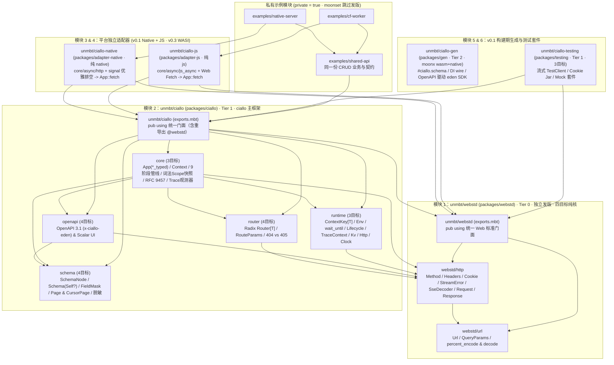
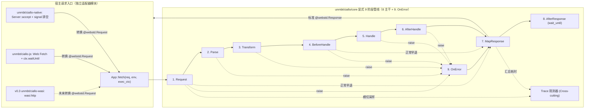

# Web 标准调研剖析与 MoonBit 版架构设计总结

本文档系统整理 `unmbt/ciallo` 在架构立项阶段对 JS / Edge **Web 标准（WinterTC / ECMA-429）**、现代轻量与工程化 Web 框架（**Hono**、**h3 / srvx**、**ElysiaJS**）以及 **MoonBit Web 生态现状**的深度评估，并将调研结论收敛为 `unmbt/ciallo` 的核心差异化路线与全景架构蓝图。

---

## 1. 什么是现代服务端“Web 标准”（WinterTC / ECMA-429）

### 1.1 历史背景：从运行时私有对象到 Web Platform API

2009 年 Node.js 诞生时，浏览器端尚无 `fetch`、`Streams`、`URL` 或 `WebCrypto` 等现代规范，Node.js 基于 C++/libuv 发明了私有体系（`http.IncomingMessage` / `http.ServerResponse`、`Buffer`、`node:stream`、`EventEmitter`）。Express、Koa、Fastify 等老牌框架强绑定于这一对 Node 专属对象。

随着 **Deno、Cloudflare Workers、Bun、Vercel Edge、Fastly Compute** 等边缘与多运行时崛起，边缘环境往往没有传统 POSIX 文件系统或 libuv 线程模型。各运行时达成共识：**服务端/边缘运行时不再各造一套私有 HTTP 对象，而是直接复用 WHATWG / W3C 已标准化的 Web Platform API。**

### 1.2 服务端核心 Web 标准拼图

1. **Fetch API（核心数学抽象）**：`Request`、`Response`、`Headers`、`fetch()` 将整个 HTTP 服务抽象为一个纯函数签名：
   ```ts
   type Handler = (req: Request) => Response | Promise<Response>
   ```
   只要底层宿主能构造标准 `Request` 并消费标准 `Response`，框架与应用业务代码即可彻底与底层传输层（TCP Socket、V8 Isolate、Service Worker、`wasi:http`）解耦。
2. **Streams API**：`ReadableStream` / `WritableStream` / `TransformStream`，原生支撑大文件流、Server-Sent Events（SSE）与 AI 流式响应。
3. **URL 与路由标准**：`URL`、`URLSearchParams`、`URLPattern`。
4. **二进制与安全原语**：`Uint8Array` / `ArrayBuffer`、`Blob`、`File`、`FormData`、`TextEncoder`/`TextDecoder`、`Web Crypto API`、`AbortController`。

### 1.3 标准化进程：从 WinterCG 到 WinterTC（ECMA-429）

为补充浏览器标准在服务端场景的空白（如流式上传、服务端构造 `Response.json()` 等），Cloudflare、Deno、Node.js 等在 2022 年发起 W3C **WinterCG** 社区组；2024 年底至 2025 年初正式升级为 Ecma International **TC55 技术委员会（简称 WinterTC）**，与 TC39 平级。2025 年底发布的 **ECMA-429（Minimum common web API）** 正式确立了跨运行时必须支持的最小公共 Web API 集合，推动 Node.js、Bun、Deno 与边缘节点全面向同一套 HTTP 语义收口。

---

## 2. Hono、h3、ElysiaJS 架构剖析与 MoonBit 契合度评估

### 2.1 三大现代 JS Web 框架核心机制对照

| 框架 | 核心机制与架构基因 | MoonBit 直接移植适配度 | 核心契合点 | 主要水土不服之处 |
| :--- | :--- | :---: | :--- | :--- |
| **Hono** | 诞生于 Cloudflare Workers，零外部依赖；以标准 `Request -> Response` 为入口，内核仅由**高速路由（RegExp/Trie）+ 洋葱中间件 + 轻量 `Context`** 构成，靠极薄适配器兼容 Node.js | ⭐⭐⭐⭐⭐（骨架最适合） | 架构极简、零运行时黑魔法、多运行时基因与 MoonBit 多后端天然同频、极致小体积 | TS 版 `hc`（Hono Client）依赖模板字符串类型推导（MoonBit 可直接通过**跨后端共享类型包**降维取代）；大型工程下纯洋葱中间件易出现顺序耦合 |
| **h3 (v2)** | UnJS / Nuxt Nitro 引擎，v2 彻底转向 Web Standards First；基于类 `URLPattern` 路由 `rou3`，并将多运行时启动层抽离为通用服务器层 **`srvx`** | ⭐⭐⭐⭐（底层启发极深） | **`srvx` 统一服务器抽象层思想极有价值**；组合式 Handler 与 `rou3` 路由树极易在 MoonBit 落地 | 强依赖 JS 动态返回类型（字符串/对象/流随便 `return`），在静态语言需显式 `IntoResponse` trait 或枚举包装 |
| **ElysiaJS** | 面向 WinterTC 兼容 + 工程与性能极致：显式分阶段生命周期、插件局部隔离、Type Soundness 全分支契约、单一数据源 Schema/OpenAPI/脱敏、内置 Trace | ⭐⭐（直接移植 TS 实现）<br>⭐⭐⭐⭐⭐（**吸收架构哲学用 MoonBit 重塑**） | **工程理念最超前**：显式管线、局部作用域、全分支错误契约、出参脱敏、内置 Trace，用 MoonBit 原生 `enum`/`suberror`/`trait`/`#derive` 实现甚至更干净 | 两大 TS 实现外壳在 MoonBit 中完全失效且不需要：① 运行时 `new Function` 拼字符串 AOT（Sucrose）；② 极限链式泛型 TypeScript 类型体操（Eden Treaty） |

### 2.2 为什么必须深度吸收 ElysiaJS 的六大工程哲学？

剥离 TypeScript 语言限制的变通技巧后，ElysiaJS 代表了现代服务端框架工程体验的制高点，且这 6 项思想在静态编译的 MoonBit 中实现起来比 TypeScript 更优雅、零运行时黑魔法且编译飞快：

1. **显式 9 阶段生命周期管线（Lifecycle Pipeline），取代模糊的“洋葱中间件”**：
   - 传统洋葱模型把鉴权、Body 解析、参数校验、日志、错误捕获全塞进 `async (c, next) => ...`，大型项目极易陷入**顺序地狱**、职责模糊与多层异步闭包分配。
   - ElysiaJS 将单次请求明确拆解为：`Request` → `Parse` → `Transform` → `BeforeHandle` → `Handle` → `AfterHandle` → `MapResponse` → `AfterResponse`，外加专属 `OnError` 与 `Trace`。在 MoonBit 中按阶段枚举直调，未注册钩子的阶段零开销直接跳过，逻辑一目了然。
2. **默认局部作用域隔离（Encapsulation）与依赖去重**：
   - 借鉴并进化自 Fastify：子插件或子模块默认仅处于 `Local` 作用域，钩子绝不意外污染父应用或兄弟模块；需向外暴露时必须显式声明 `Scoped` 或 `Global`。同时插件以 `(name, seed)` 标识身份，被多个模块重复挂载时自动去重只执行一次，与 MoonBit 严格的包可见性哲学高度契合。
3. **“全分支类型完备性（Type Soundness）”：把错误分支也纳入 API 契约**：
   - 多数“类型安全”框架只保 `200 OK` 成功分支，鉴权 `401`、校验 `422` 仍靠文档约定。MoonBit 原生具备**代数数据类型 `enum` + 类型化异常 `pub(all) suberror` / `raise` + 编译器强制穷尽检查（Exhaustive `match`）**，无需 TS 类型体操即可把所有错误状态码、校验错误结构纳入强类型契约与 OpenAPI 文档。
4. **单一数据源（Single Source of Truth）+ 响应脱敏（Exact Mirror Normalization）**：
   - 路由上的一份 `Schema` 定义同时驱动四件事：① 入参校验与字符串自动类型转换（Coercion，如 Query `"123"` → `Int32`）；② 静态类型/模型反序列化；③ 自动生成 OpenAPI 3.1 文档；④ **出参严格白名单脱敏**——即使业务逻辑返回了含 `passwordHash` 等敏感字段的完整模型，序列化输出时也会按响应 Schema 自动剥离未声明字段，从架构根源杜绝敏感字段泄露。
5. **声明式横切复用（`Guard` 与 `RouteOptions`）**：
   - 通过具名路由配置结构体与 `guard_group` 组合器，将鉴权、校验 Schema、生命周期钩子与 OpenAPI 安全元数据统一绑定到单条路由或一组路由，保持代码扁平可读。
6. **现代可观测性与按需付费（Pay-for-what-you-use）**：
   - 内置 `Trace` 生命周期耗时审计，精确度量每个阶段毫秒/微秒级耗时；若某条路由从未访问 `query`、`cookies` 或 `body`，框架绝不执行多余解析，将热路径损耗压至最低。

---

## 3. 借鉴与扬弃矩阵（Adopt vs Rethink）

| 设计维度 | 上游参考做法（Hono / h3 / ElysiaJS） | `unmbt/ciallo` 决策 | 工程原因与收益 |
| :--- | :--- | :--- | :--- |
| **HTTP 核心抽象** | Hono Fetch 入口 + h3 `srvx` 通用服务器抽象 | **吸收并独立发包**：拆出独立四目标纯血模块 `unmbt/webstd`（`http` / `url`），上层 `unmbt/ciallo` 暴露 `App::fetch(Request) -> Response` | 与任何传输层彻底解耦，`unmbt/webstd` 可独立作为社区 WinterTC 公共标准包；一套业务代码无缝编译到 Native、JS Edge 与未来 WASI |
| **路由引擎** | Hono RegExp/Trie + h3 `rou3` Radix Tree | **吸收**：纯函数 `Router[T]` Radix/Trie，静态 > 参数 > 通配，编译期冲突检查 | 无正则回溯风险，四目标通用且支持 `404` / `405 Allow` / `HEAD` / `OPTIONS` 语义 |
| **中间件与管线** | Hono 无限洋葱闭包链 vs Elysia 9 阶段管线 | **扬弃洋葱，吸收 9 阶段管线**：仅在 `App` 核心按显式阶段顺序调度 | 消除 `use()` 顺序地狱与闭包嵌套栈，使执行流、Trace 剖析与早退短路完全确定 |
| **作用域与插件** | Express/Hono 全局挂载易污染 vs Elysia `local/scoped/global` | **吸收**：默认 `Scope::Local`，显式 `Scoped`/`Global` + `(name, seed)` 去重 | 模块化微服务与多团队协作不互相踩踏 |
| **端到端 RPC 类型** | TS 链式泛型推导（`hc` / Eden Treaty） | **构建期 `ciallo-gen eden` 双端 SDK 生成**：直接从路由契约 / OpenAPI 3.1 导出 **强类型 MoonBit SDK** + **零依赖 TypeScript SDK（`.ts` + `.d.ts`）** | 既省去 TS 极端类型体操，又打通前后端异构栈（React/Vue/Next.js + MoonBit 后端），改字段或错误分支时前端 `tsc` 当场红线报错 |
| **Schema 与 Struct 同步** | TypeBox `Static<typeof schema>` 运行时推类型 | **统一 `pre-build` 代码生成（`#ciallo.schema`）** + 双轨零开销出参脱敏 | 彻底根治 `struct` 与 `SchemaNode` 双份维护分裂；强类型 DTO（`ctx.ok`）走编译期脱敏 0 额外遍历，动态 JSON 兜底走 `normalize_json` |
| **DI / 插件装配与运维** | Spring Boot 运行时反射 IoC / Starter / Actuator | **取灵魂去反射**：`ciallo-gen wire` 编译期 DI + `Virtual Package` + 拓扑 `Lifecycle` + `CapabilityBundle` + `ciallo-actuator` | 保留“引包配一行即全套就绪”与 K8s 运维完备度，同时守住 MoonBit 的 Tree-shaking、冷启动与编译期循环依赖检查 |
| **企业级标准件** | GoFrame 全家桶工具箱（但大单体耦合 + 动态 `gvar`） | **拆分为按需 Tree-shake 微包集群 `ciallo-kit`**（`config`/`Secret[T]`、`problem` RFC 9457、`log`、`id` UUIDv7、`pagination`、`security`、`resilience`、`queue`） | 消灭选型疲劳与弱类型陷阱，绝不向 `webstd` 与 `ciallo` 纯核塞入任何多余体积 |
| **韧性、可观测与 AI-Native** | Rust Tower / Stripe API / OpenTelemetry / MCP | **结构化并发取消传播** + **`Idempotency-Key`/限流/熔断** + **W3C `traceparent` & SQLCommenter** + **一等公民 SSE & `ciallo-mcp`** | 防止僵尸协程打满连接池；慢 SQL 反查接口行号；同一份 `App` 零额外代码同时服务人类前端（HTTP/OpenAPI/Scalar）与 AI Agent（MCP） |
| **动态性能优化** | Elysia 运行时 `new Function` 拼 JS 代码 AOT | **扬弃**：依赖 MoonBit 编译器静态优化（Native/Wasm/Tree-shaken JS） | 静态编译语言无运行时 `eval`，零冷启动 JIT 拼装成本且符合边缘安全沙箱 |
| **Serverless 上下文** | Hono `c.env` / `c.executionCtx.waitUntil` | **吸收为一等公民**：内建 `Env`、`ExecutionContext::wait_until` 与 `KvStore`/`HttpClient`/`Clock`/`HealthCheck` trait | 统一本地常驻后台任务与 Cloudflare Workers `ctx.waitUntil`，消除全局状态陷阱 |
| **异步底座** | 外部 `moonbitlang/async` | **扬弃外部包**：统一采用标准库 `moonbitlang/core/async*`（`http` / `js_async` / `io`） | 零外部第三方运行时依赖，避免下游版本冲突，对齐 `unmbt/moonset` 与 `unmbt/clack` |

### 3.1 从 Spring Boot、GoFrame、Rust Tower 与 AI 生态吸收的六大工程支柱

在 Hono / h3 / ElysiaJS 之上，`ciallo` 进一步吸收了传统企业级与现代云原生生态的六大高杠杆设计，并全部以 MoonBit 静态原生范式重构（详见 [ADR-007](decisions/007-unified-codegen-dual-track-normalization-and-extractors.md) ~ [ADR-009](decisions/009-phased-release-cadence-v01-v03-and-incubation.md)）：

1. **Spring Boot 的灵魂，无反射之痛**：摒弃运行时反射容器，以 **`ciallo-gen wire` 编译期 DI** + **MoonBit `Virtual Package`** + **`Lifecycle` 拓扑逆序优雅启停** + **`CapabilityBundle`（Starter 等价协议）** + **`ciallo-actuator`（`/healthz` `/readyz` `/metrics`）** 达成零反射、零冷启动损耗的装配与 K8s 运维完备度。
2. **GoFrame 的标准件，无单体与 `gvar` 之弊**：将配置（含 **`Secret[T]`** 防密钥误打日志）、**RFC 9457 Problem Details**、结构化日志、**UUIDv7** / ULID / Snowflake、统一 `Page[T]` / `CursorPage[T]` 分页与安全守卫全部拆成按需 Tree-shake 的 **`ciallo-kit` 微包集群**。
3. **Rust Axum + Tower + `sqlx::test` 级体验**：利用 MoonBit `raise` 异常自动传播提供零嵌套 `ctx.param_as`/`query_as`/`json_as`/`require` Extractor；入站路由与出站 `HttpClient` 共享限流/熔断/重试与 Stripe 风格 **`Idempotency-Key`** 韧性原语；依托 `core/async` `with_task_group` 实现**请求级取消传播**；`ciallo-testing` 提供流式 `TestClient` 与 ORM **用例级自动事务回滚测试**。
4. **Drizzle Kit 级数据库迁移闭环**：`ciallo-migrate`（集成进 `ciallo-gen migrate`）提供 `diff` / `status` / `apply` / `verify`（`_ciallo_migrations` 校验和防漂移）/ `seed`，配合 `v0.2` 聚焦打透 PostgreSQL + SQLite/Cloudflare D1。
5. **W3C OpenTelemetry 全链路贯通**：入口解析 `traceparent` / `tracestate`、出站 `HttpClient` 自动透传、ORM **SQLCommenter**（`/* traceparent='...', loc='users.mbt:42' */`）与异步批量 OTLP Exporter。
6. **2026 AI-Native 原生能力**：`v0.1` 一等公民 **SSE / NDJSON Streaming** + **Scalar 交互式 UI** + 全公开包 **`SKILL.md`**（适配 `mooncakes.io` AI Agent 检索），`v0.3` 凭借路由既有 `SchemaNode` 零额外代码推出 **`unmbt/ciallo-mcp`**（路由即 MCP Server / LLM Tool Calling）。

---

## 4. MoonBit Web 生态全景与 `unmbt/ciallo` 差异化定位

### 4.1 MoonBit 生态三条底层准标准路线

由于 MoonBit 编译到 **Native**、**Wasm**、**JS** 三大后端，目前 HTTP 底层分化为三条路线：
1. **官方标准库异步底座 `moonbitlang/core/async/http`**：基于结构化并发，提供原生 HTTP Server（支持 `native` / `wasm`）与 Client（支持 `native` / `js` / `wasm`），但 Server 端无法用于 Cloudflare Workers 等 JS Serverless 宿主。
2. **云原生 Wasm 标准 `wasi:http`（Component Model）**：通过 `wit-bindgen` 对接 `wasi:http/incoming-handler`，编译产物仅数十 KB，面向 Wasmtime / Fermyon Spin / wasmCloud。
3. **JS / Edge Web 标准互操作（`core/async/js_async` + Web Fetch）**：MoonBit `--target js` 产出经过激进 Tree-shaking 的极简 ES Module，直接跑在 V8 Isolate（Cloudflare Workers / Vercel Edge / Deno / Bun）内，**规避了在 V8 中运行 Wasm 的动态实例化限制与跨边界字符串/JSON 拷贝损耗**。

### 4.2 现有 MoonBit Web 框架全景对比

| 维度 | `moonbitlang/moonback`（官方） | `crescent`（`mocket` 分叉） | `oboard/mocket` | `mizchi/mars.mbt` | **`unmbt/ciallo`** |
| :--- | :--- | :--- | :--- | :--- | :--- |
| **支持后端** | Native + Wasm (`moonrun`)，**不支持 JS/CF** | Native + Wasm，**明确放弃 JS** | Native + Wasm + JS | Native + JS (Node / CF Workers) | **JS (CF/Edge/Node) + 纯 Native + (`v0.3`) WASI `wasi:http`** |
| **底层依赖** | 绑定 `async/http` | 绑定 `async` | 多端各自适配 | `mizchi/x` + `async` + 独立 Adapter | **纯血四目标中立核心 + 零外部依赖标准库 `core/async*` 适配器** |
| **架构风格** | 传统工程化后端（DI、优雅停机、搭配 `tyroute` 做 OpenAPI） | 类型安全（`derive` 契约 + `raise` 自动转 JSON 错误） | 轻量多后端雏形 | **Hono 风格**（Trie 路由 + 洋葱中间件 + `Env` Trait） | **中立 Web 标准底座 + Elysia 9 阶段生命周期 / 作用域隔离 / 全契约 / 脱敏 / Trace** |
| **生态定位** | 官方后端，驱动 `mooncakes.io` | AI 友好、Native 优先全栈后端 | 早期探路者 | 服务于 `mizchi` 的 `sol`/`astra` 全栈生态 | **MoonBit 的 WinterTC / `srvx` 通用底座 + 下一代跨端 API 工程框架** |

### 4.3 现实阻力与破局策略（底层做标准，上层做代差，节奏分步走）

在立项阶段必须正视四项现实工程挑战并制定对策：
1. **三端维护呈指数级成本（木桶效应）**：`crescent` 分叉 `mocket` 时之所以砍掉 JS，正是因为同时维护三端复杂特性（流式/WS/Multipart）精力巨大。**对策**：`v0.1` 集中火力打穿 **JS (CF Workers / Edge / Deno / Bun / Node) + 纯 Native (`core/async/http` + `core/async/signal`)**（覆盖 95%+ 实际部署场景），`v0.2` 聚焦数据闭环，将 `wasi:http` 与 `WebSocket` 稳健安排在 **`v0.3`**（详见 [ADR-009](decisions/009-phased-release-cadence-v01-v03-and-incubation.md) 与 [ADR-010](decisions/010-phase0-precheck-resolutions.md)）。
2. **存储与生态中间件跨端割裂**：Native 用 SQLite/Postgres，CF Workers 用 D1/KV/HTTP DB。**对策**：在 `runtime` 包内建 `Env`、`ExecutionContext` 与可移植能力 trait（`KvStore`、`HttpClient`、`Clock`）及内存测试桩，引导业务代码面向接口编程。
3. **双向生态夹击**：Native 已有 `moonback`/`crescent`，JS/CF 已有 `mizchi/mars.mbt`。**对策**：不做“第二个 Hono 克隆”，而以 **Elysia 级工程深度（9 阶段管线 + 默认局部隔离 + `suberror` 全分支契约 + Schema 出参脱敏 + OpenAPI 3.1 + 内置 Trace）** 拉开代差，并把 `http` / `router` 沉淀为社区可独立复用的“MoonBit 版 `http` + `srvx`”标准底座。
4. **中立抽象层转换损耗**：**对策**：核心层采用 `BytesView` 切片与延迟按需解析（未读取不分配），在常规业务逻辑中将转换损耗控制在微秒级以内。

---

## 5. `ciallo` Workspace 全景架构设计总结

### 5.1 多模块 Workspace（`moon.work` + `moonset`）分层 DAG 拓扑



### 5.2 9 阶段生命周期与跨端执行数据流



### 5.3 核心概念映射对照表

| 概念维度 | JS 参考原型（Hono / h3 / ElysiaJS） | `ciallo` Workspace 对应设计 |
| :--- | :--- | :--- |
| **HTTP / URL 标准原语** | WinterTC `Request` / `Response` / `Headers` / `URL` + `srvx` | 独立四目标纯血模块 **`unmbt/webstd`**（`http` + `url` + 同步 `SseDecoder`，生产零异步） |
| **核心调度入口** | Hono `app.fetch(req, env, ctx)` | `unmbt/ciallo` `App::fetch(self, req, env?, exec_ctx?) -> @webstd.Response`（全函数收口） |
| **平台运行时适配** | `@hono/node-server` / `srvx` | 独立适配模块 **`unmbt/ciallo-native`**（纯 `native`）与 **`unmbt/ciallo-js`**（`v0.3` 增 `unmbt/ciallo-wasi`） |
| **请求处理模型** | Hono 洋葱 `(c, next)` vs Elysia 9 阶段管线 | `LifecyclePhase` 9 阶段（8 主干 + `OnError`）+ 横切 `Trace` 观测器 + 正常早退直达 `MapResponse` |
| **插件封装与状态注入** | Elysia `local` / `scoped` / `global` + `name/seed` | 词法注册快照 `Scope`（默认 `Local`）+ `PluginMeta(name, seed)` 去重 + 零反射闭包槽位 **`ContextKey[T]`** |
| **全分支错误契约** | Elysia `status(401, ...)` 联合类型推断 + RFC 9457 | `pub(all) suberror HttpError`（RFC 9457 `application/problem+json`）+ 业务 `ErrorMapper` + OpenAPI 错误响应列表 |
| **单一数据源、强类型路由与双轨脱敏** | TypeBox/Exact Mirror + Axum Extractors | `#ciallo.schema`（`moonx` + `dev_build`）+ 主力 `*_typed` 路由 + 原生 `raise` Extractor + O(1) `schema_id` 防绕过脱敏 & Opt-in `FieldMask` |
| **端到端 RPC 与 AI-Native** | Eden Treaty + MCP Server | `ciallo-gen eden --from openapi.json`（强类型 MoonBit + 零依赖 TS SDK）+ 同步 `SseDecoder` & Scalar UI + `v0.3` `ciallo-mcp` + 包级 `SKILL.md` |
| **DI、生命周期、运维与工具箱** | Spring Boot (DI/Starter/Actuator) + GoFrame + Tower | `ciallo-gen wire` 编译期 DI + `Virtual Package` + 拓扑 `Lifecycle` 优雅排空 + `CapabilityBundle` + 取消传播 + W3C OTel & SQLCommenter + 按需 `ciallo-kit` 微包 |
| **跨端异步能力** | Node/CF Fetch / KV / `ctx.waitUntil` | `runtime::ContextKey[T]` / `Env` + `ExecutionContext::wait_until` + `KvStore`/`HttpClient`/`Clock`/`HealthCheck` trait |
| **多包发版治理** | Changesets Monorepo | `moon.work` + **`unmbt/moonset`**（独立 `webstd` 版本线 + `linked` Web/Data 组 + 拓扑发布） |
